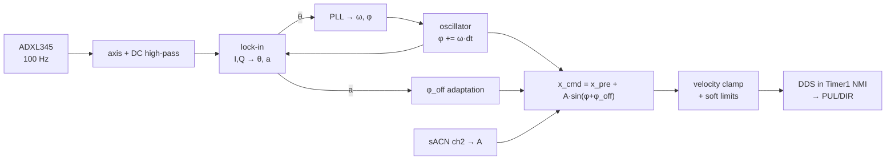
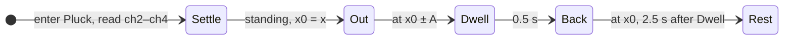

# CONTROL_LOOP.md — Tensegrity sway drive, PoC firmware

Target: NodeMCU (ESP8266) driving a JD57 integrated closed-loop stepper. Language-agnostic. **DECISION** = needs a human call; **ASSUMPTION** = check against hardware.

## 1. What it does

1. **Blackout:** coils released, identical to power loss. Also the idle state.
2. **Hold:** coils enabled, no steps: the shaft locked where it is.
3. **Pluck:** one tug on the guy wire, of a size, direction and speed the desk sets, then back to where it began, and held there.
4. **Manual:** turn the shaft at a speed and in a direction the desk sets, to wind the wire and to test the motor.

None of the four needs homing or the accelerometer. **The firmware follows the desk and does not decide**: the mode in the frame is the mode, and no mode is entered or left by the firmware's own choice. The one exception is a lost universe, which is Blackout (§4).

**Run**, later and not in the mode channel yet: phase-lock a local oscillator to the sway and drive the motor in phase with the structure's velocity at an amplitude the desk sets, the drive phase adapted continuously. The structure's sway frequency `f` and quality factor `Q`, which seed it, come from a ring-down; how that ring-down is recorded is decided with Run. §3 is Run's design.

## 2. Hardware

Guy wire wrapped a few turns around the bare motor shaft (capstan; tail tied off) → short cable → hook → rubber bands in parallel → hook → wire to the structure. Motor sits on a bar-type load cell. One ADXL345 accelerometer on the structure.

- Shaft **ASSUMPTION** 8 mm diameter: 25.1 mm of wire per revolution. Driver at 800 steps/rev: 31 µm per step.
- `x` = shaft position in steps, counted by the step generator. In Hold, Pluck and Manual it has no home and means only distances. With Run: positive = reel in, `x = 0` at the homing switch (pay-out end, bands still stretched), `x_pre` = resting position, all drive motion relative to `x_pre`.
- Bands are the series spring: motor position → force, wire never slack as long as `x ≥ 0`. Preload keeps the wire taut, so there is no backlash.
- Load cell reads wire tension (motor's reaction force along the cell axis; wire leaves the shaft along that axis). Telemetry only. Not in the phase loop.
- **Unpowered, the shaft holds only by detent torque** (≈ 8–15 N of wire tension, **ASSUMPTION**; measure). If band preload is above that, Blackout unwinds the wraps and the motor guy goes slack. **DECISION:** fit a backup guy (fixed, slightly longer) so the structure stands without the motor guy, or keep preload below the detent hold.

### Pins (common anode at 3.3 V: GPIO sinks the opto cathode, LOW = opto on)

| GPIO | Pin | Function |
|---|---|---|
| 14 | D5 | PUL |
| 12 | D6 | DIR |
| 0 | D3 | ENA (see fail-safe) |
| 13 | D7 | homing switch, NO to GND, internal pull-up |
| 5 / 4 | D1 / D2 | ADXL345 SCL / SDA, I²C 400 kHz |
| 15 / 16 | D8 / D0 | HX711 SCK / DOUT |
| 3 | RX | ALM from the driver (open collector, internal pull-up) |
| 2 | D4 | LED |
| 1 | TX | serial log out |

Board rules: GPIO15 low at boot (SCK idles low, fine); GPIO0/GPIO2 high at boot (so no switch and no common-cathode opto on them); GPIO16 has no interrupt (HX711 DOUT is polled); 12 mA per pin (each opto ≈ 8 mA at 3.3 V — **measure**; if under 7 mA, drive the optos from 5 V with a 1N4148 in series with each cathode).

**ENA fail-safe.** High-Z on any pin is opto-off. Test whether opto-on disables or enables the driver. If opto-off = disabled: ENA straight to GPIO0. If opto-on = disabled: N-MOSFET, gate to GPIO0 with 10 kΩ pull-up, drain to the ENA cathode. Either way the firmware contract is: **GPIO0 driven low = enabled, GPIO0 released to input = disabled.** Reset, crash, boot and Blackout all leave it released. Wait 100 ms after enabling before the first pulse. Pressing FLASH at runtime = enable (harmless, no pulses).

Power: MCU on 5 V, sensors on its 3.3 V; motor on its own 42 V (**ASSUMPTION**); no ground tie, the optos are the only link. Keep the ADXL345 cable away from the motor cable.

## 3. The loop

Run's, later; nothing in this section is built yet but the step generator and the HX711.

Control tick nominal 200 Hz, `dt` measured. Nothing in the loop crosses the network.

**Oscillator.** `φ += ω·dt`, wrapped. `ω` seeded from `f_est` (persisted, from Pluck).

**Sway signal.** One ADXL345 axis (auto-picked at Pluck as the one with the largest ring-down), slow DC high-pass. No other filtering: the lock-in is the band-pass.

**Lock-in.** `I = LPF(s·cos φ)`, `Q = LPF(s·sin φ)`, time constant 3–5 cycles of `f`. `θ = atan2(Q, I)` is the sway's phase relative to the oscillator; `a = 2√(I²+Q²)` is its amplitude. `atan2`/`sqrt` at 20 Hz, not every tick (soft-float).

**PLL.** `e = wrap(0 − θ)`. `ω += K_i·e·dt`, `φ += K_p·e`, loop bandwidth ≈ `f/100`. Clamp `ω` to ±20 % of `f_est`. A loop this slow does not care about sensor latency or dropped samples. `locked` = `a > a_lock_min` and `|e| < e_lock` for 5 cycles.

**Drive.** `x_cmd = x_pre + A·sin(φ + φ_off)`. `A` is in steps, straight from sACN channel 2; the loop does not regulate the structure's amplitude, the desk sets how far the shaft turns. The tick turns `x_cmd` into a velocity (clamped to `v_max`, zero if it would cross `0` or `x_max`); the NMI integrates it into pulses.

**φ_off adaptation** — the only phase calibration, always on in Run. `φ_off` absorbs every lag in the chain (sensor, filter, motor, bands, structure) and is learned, not computed.
- *Acquire* (not locked, or `a` too small to tell): drive at `A_seed`; if `a` is not growing after 5 cycles, step `φ_off` by 90°; try at most four quadrants, keep the one with the fastest growth, bisect once (±45°) and again (±22.5°).
- *Track* — **extremum seeking**, the part that follows wind, temperature and band drift while the show runs (locked, `A` unchanged for 5 cycles). Square-wave dither of `d = ±8°` on `φ_off`, period 30 cycles. At the end of each period, `g = (ā_high − ā_low) / (2d)` from the mean sway amplitude in the two halves; `φ_off += K_adapt·g`, step clamped to 5°. The sway amplitude at fixed drive is largest when the drive is in phase with velocity, so this climbs to the optimum and stays on it as it moves. Paused while `A` is changing (a changing drive moves `a` for reasons that have nothing to do with phase). Clamped to ±60° of the acquired value; falls back to *Acquire* if the clamp is hit repeatedly.
- Persisted at most once a minute.

**Step generation.** Timer1 as NMI at 25 kHz. Phase accumulator; a carry starts a pulse and the next tick ends it, so every pulse is 40 µs low and at least 40 µs high; DIR written only while stopped, between pulses, 10 µs before the next can start. Usable step rate ≤ 12.5 kHz = 390 mm/s of wire, which is also where motor torque falls off (~900 rpm). That is the hardware ceiling, not the setting: `v_max` is hard-coded to what the model needs, `≈ 1.2 × 2π·f_max·A_max` — about 150–200 mm/s for 5–10 mm at 3 Hz — so that a bad `f_est` or a desk snap cannot do more than the show would. Hold, Pluck and Manual use the step generator's ceiling. A signed step count `x` is kept in the NMI, and the NMI stops itself on a target count when one is set, so a late control tick cannot overshoot a move. Write idle levels before switching pins to OUTPUT.

**The ramp.** One for every mode, so no mode has motion code of its own. A mode asks for a speed, or for a position to stop on; the motion stage changes the speed by at most `a_ramp·dt` a tick, takes a change of direction through zero, and, with a position to stop on, caps the speed at `√(2·a_ramp·remaining)` so the shaft stops on it. Every controlled change of speed goes through the ramp. Blackout is not a change of speed: it releases the coils at once, moving or not.

**HX711.** 80 SPS (RATE pin high). The 25-clock readout runs with interrupts masked (~60 µs) because SCK high > 60 µs powers the chip down; the NMI is unaffected.

**ADXL345.** I²C 400 kHz, ±2 g full-res, ODR 200 Hz, polled at 100 Hz with one 6-byte burst (~0.25 ms). Not SPI: the hardware SPI pins are taken by PUL/DIR/switch and a 4-wire MHz bus over a cable to a moving structure is the fragile option.

## 4. Modes

**The mode is the frame's.** On every live frame, ch1 sets the mode, from any mode to any mode, on the next tick. The new mode takes over from wherever the shaft is and whatever it is doing, through the ramp (§3); nothing in between, no mode reached by way of another. After a lost universe, a stopped brain or a reboot, the first live frame sets the mode as any frame does.

**sACN lost is Blackout**, at once: no frame for 2.5 s, or Stream-Terminated. The only mode the firmware enters by itself.

Leaving Blackout enables the coils; no step is made for 100 ms after, as the driver asks. `x` has no home: it counts from boot and means only distances.

**Blackout.** ENA released, rate 0, at once, moving or not. Sensors and telemetry keep running (the load-cell calibration readings are taken here). The idle state.

**Hold.** Enabled; asks the ramp for speed 0. Turning when Hold begins, the shaft ramps to a stop and is held where it stopped.

**Pluck.** One tug, once per entry:

- *Entry.* Ch2, ch3 and ch4 are read once, on the tick Pluck begins, and ignored for the rest of the pluck: `A` from Amplitude, the tug's direction from Direction, its speed `v` from Speed.
- *Settle.* Turning, the shaft ramps to a stop. `x0` is where it stands. From Blackout, Out makes no step until the 100 ms after enabling are over.
- *Out.* To `x0 + A` in ch3's direction, at up to `v`, ramped up and down; a short tug never reaches `v`.
- *Dwell.* Held at the target for 0.5 s.
- *Back.* To `x0` at `A / 2.5 s`; its ramps, at `a_ramp`, take about a millisecond, so it takes 2.5 s.
- *Rest.* Held at `x0`, enabled, until the mode leaves Pluck. Another pluck needs the mode to leave Pluck and come back.
- `A = 0` or `v = 0`: nothing moves; Settle goes straight to Rest.
- The mode leaving Pluck at any point ends the pluck there; the new mode takes over from where the shaft is.

**Manual.** Turn the shaft in ch3's direction at ch4's speed, both followed live, through the ramp. Speed 0 holds the shaft, enabled. Ch2 is ignored.

## 5. Protections (all there are)

- sACN lost → Blackout, immediately.

Nothing else acts: the firmware reports, the desk decides. ALM asserted (the driver has already freed the motor; polarity by test) and the load cell's tension are in the telemetry. Soft limits, a stale ADXL345 and the home switch come with Run.

## 6. sACN (in)

One universe (**DECISION:** number). 10–40 Hz, irregular; levels sampled per frame and held; **never a clock** — every timeout runs on the MCU clock.

| Ch | Function |
|---|---|
| 1 | Mode: 0–63 Blackout · 64–127 Hold · 128–191 Pluck · 192–255 Manual |
| 2 | Amplitude `A`, in Pluck only, read at its start: 0–255 → 0 … `A_max` steps, the size of the tug |
| 3 | Direction, in Manual, and in Pluck read at its start: 0–127 clockwise · 128–255 counter-clockwise, facing the shaft |
| 4 | Speed, in Manual, and in Pluck read at its start: 0 stopped; 1–255 → slow … 12.5 kHz, the step generator's ceiling |

`fixtures/wrist.qxf` is the source of these bands; this table is a rendering of it.

## 7. OSC (out only)

Always on, sent to each OSC recipient `clockwork.dot` names for Wrist, logged to a remote database. The address space, and how each address is sent, is `fixtures/wrist.oscquery.json`; the file's format, its roots (`/wrist/`, `/dmx/wrist/`, `/sys/wrist/`) and the three ways to send are `DESIGN.md`'s OSC section. The encoders, and the brain's decoders, are **generated from it at build time**, both through one reader, `clockwork/oscquery.py`. Whether the MCU also serves it over HTTP/mDNS: **DECISION**.

Only loop variables and raw inputs are sent. Nothing is computed for telemetry: no Hz (`ω` is sent), no settle times (derive from transition timestamps in the database), no CPU estimate.

The file holds only what the firmware sends so far: the mode, the alarm, the load cell, the tick interval, where Wrist sits on the universe and how fresh its frames are, and what it runs on.

**`/wrist/pluck`**, in the 10 Hz state bundle, says whether a pluck can be started, for a show to start one by:

| value | when |
|---|---|
| `busy` | in Pluck, from its entry until the shaft is back at `x0` |
| `can` | in Hold: Pluck in the next frame would tug |
| `cannot` | at every other time: Blackout, Manual, and Pluck at Rest |

To come with Run, each value its own message: homed and locked; `osc/omega`, `osc/phase`, `pll/err`, `amp/a`, `drive/A`, `drive/phase_off`, `adapt/regime`, `motor/x`; the accelerometer's three axes and the sway, on each reading; the persisted tuning values `f_est`, `Q_est`, axis and `phase_off`, which are what the firmware has learned, and reading them is how the coded-in defaults get updated by hand; and the transitions and ring-down results as they happen.

Nothing comes in over OSC. Calibration constants are coded in (§10); the raw readings needed to derive them are in the telemetry. **Load-cell calibration** (once per rig, in Blackout): unhook the wire, average `load/raw` from the database → `tare`; hang a known mass `m`, average → `scale = m·g/(raw − tare)`, in N per count, so the force is `(raw − tare)·scale`; put both in the code and rebuild.

## 8. Persisted (LittleFS)

With Run. `f_est`, `Q_est`, axis, `φ_off` — the values the system learns. Written when a ring-down is measured; `φ_off` at most once a minute. Loaded at boot; the coded-in defaults are used only when nothing is persisted (first boot, or after a flash erase). Reported over OSC so the defaults can be updated by hand.

## 9. LED

Solid while the coils are enabled: Hold, Pluck and Manual. 1 Hz blink in Blackout, released.

## 10. Hard-coded constants

| | Value | Note |
|---|---|---|
| `steps_per_rev` | 800 | DIP switches |
| `a_ramp` | steps/s² | the one ramp, every mode; sane but minimal: sharp enough for a tug, gentle enough for winding; first guess 100,000, by test; the bench ran 200,000 without an alarm, shaft free |
| `A_max` | steps | the largest tug the band set takes, by test (5–10 mm on the model); first guess 320, about 10 mm |
| longest `dt` | 5 ms | a pass of the loop held up longer, by the WiFi, changes the speed as if it took this long, at most 500 steps/s at `a_ramp` |
| Pluck's dwell, return | 0.5 s, 2.5 s | §4 |
| sACN timeout | 2.5 s | E1.31 |
| `dir_cw` | DIR level | the level that turns the shaft clockwise, facing it, with SW5 as set; by test |
| `tare`, `scale` | raw counts, N/count | measured once per rig (§7) |

With Run:

| | Value | Note |
|---|---|---|
| `v_max` | ≈ 150–200 mm/s for the 1 m model | hardware ceiling 390 mm/s (12.5 kHz); §3 |
| `x_pre`, `x_max`, `margin` | per band set, in steps | travel must stay inside the wrap |
| `A_seed` | steps | must stay ≤ `x_max − x_pre`, as `A_max` must |
| `f_est`, `Q_est`, axis, `φ_off` defaults | | starting points only; overridden by persisted values |
| `a_lock_min`, `e_lock` | sensor units, 20° | tune on the model |
| `K_p`, `K_i` | from `f/100` bandwidth | |
| lock-in τ, dither, `K_adapt`, max step | 4 cycles, ±8° / 30 cycles, tune, 5° | |

## 11. What to expect

Steady-state sway amplitude at drive `A` is `Q` times the static deflection `A` produces through the bands; rise and brake times are a fraction of `Q` cycles. Both are read off the telemetry on the real structure; this document does not predict them.

## 12. Open decisions

1. ENA polarity (by test). 2. Opto current at 3.3 V (by measurement). 3. Backup guy vs. low preload. 4. sACN universe. 5. OSCQuery served from the MCU or not.
