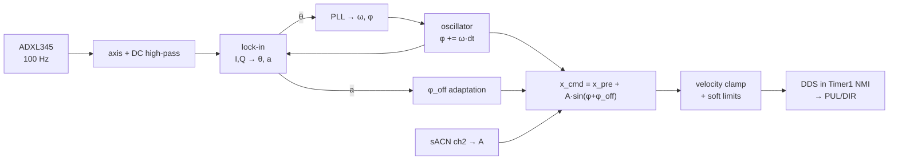
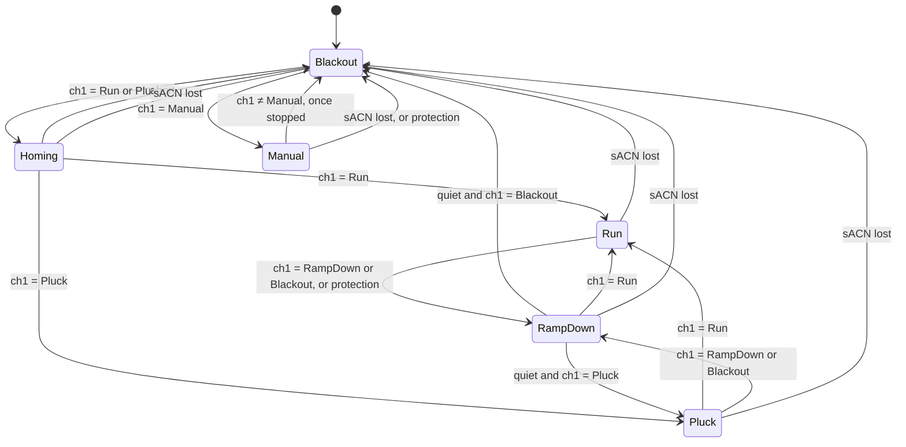

# CONTROL_LOOP.md — Tensegrity sway drive, PoC firmware

Target: NodeMCU (ESP8266) driving a JD57 integrated closed-loop stepper. Language-agnostic. **DECISION** = needs a human call; **ASSUMPTION** = check against hardware.

## 1. What it does

1. **Pluck:** one fast tug on the guy wire, then estimate the structure's sway frequency `f` and quality factor `Q` from the ring-down.
2. **Run:** phase-lock a local oscillator to the sway and drive the motor in phase with the structure's velocity at an amplitude the desk sets. The drive phase is adapted continuously; nothing is calibrated by hand.
3. **Blackout:** coils released, identical to power loss. Also the idle state.
4. **Manual:** turn the shaft at a speed and in a direction the desk sets, to wind the wire and to test the motor. Needs neither homing nor the accelerometer.

Everything else is support for those four.

## 2. Hardware

Guy wire wrapped a few turns around the bare motor shaft (capstan; tail tied off) → short cable → hook → rubber bands in parallel → hook → wire to the structure. Motor sits on a bar-type load cell. One ADXL345 accelerometer on the structure.

- Shaft **ASSUMPTION** 8 mm diameter: 25.1 mm of wire per revolution. Driver at 800 steps/rev: 31 µm per step.
- `x` = wire position in steps, positive = reel in. `x = 0` at the homing switch (pay-out end, bands still stretched). `x_pre` = resting position. All drive motion is relative to `x_pre`.
- Bands are the series spring: motor position → force, wire never slack as long as `x ≥ 0`. Preload keeps the wire taut, so there is no backlash.
- Load cell reads wire tension (motor's reaction force along the cell axis; wire leaves the shaft along that axis). Used for the two protections in §8 and for telemetry. Not in the phase loop.
- **Unpowered, the shaft holds only by detent torque** (≈ 8–15 N of wire tension, **ASSUMPTION**; measure). If band preload is above that, Blackout unwinds the wraps and the motor guy goes slack. **DECISION:** fit a backup guy (fixed, slightly longer) so the structure stands without the motor guy, or keep preload below the detent hold.

### Pins (common anode at 3.3 V: GPIO sinks the opto cathode, LOW = opto on)

| GPIO | Pin | Function |
|---|---|---|
| 14 | D5 | PUL |
| 12 | D6 | DIR |
| 0 | D3 | ENA (see fail-safe) |
| 13 | D7 | homing switch, NO to GND, internal pull-up |
| 5 / 4 | D1 / D2 | ADXL345 SCL / SDA, I²C 400 kHz |
| 15 / 16 | D8 / D0 | HX711 SCK / DOUT |
| 3 | RX | ALM from the driver (open collector, internal pull-up) |
| 2 | D4 | LED |
| 1 | TX | serial log out |

Board rules: GPIO15 low at boot (SCK idles low, fine); GPIO0/GPIO2 high at boot (so no switch and no common-cathode opto on them); GPIO16 has no interrupt (HX711 DOUT is polled); 12 mA per pin (each opto ≈ 8 mA at 3.3 V — **measure**; if under 7 mA, drive the optos from 5 V with a 1N4148 in series with each cathode).

**ENA fail-safe.** High-Z on any pin is opto-off. Test whether opto-on disables or enables the driver. If opto-off = disabled: ENA straight to GPIO0. If opto-on = disabled: N-MOSFET, gate to GPIO0 with 10 kΩ pull-up, drain to the ENA cathode. Either way the firmware contract is: **GPIO0 driven low = enabled, GPIO0 released to input = disabled.** Reset, crash, boot and Blackout all leave it released. Wait 100 ms after enabling before the first pulse. Pressing FLASH at runtime = enable (harmless, no pulses).

Power: MCU on 5 V, sensors on its 3.3 V; motor on its own 42 V (**ASSUMPTION**); no ground tie, the optos are the only link. Keep the ADXL345 cable away from the motor cable.

## 3. The loop

Control tick nominal 200 Hz, `dt` measured. Nothing in the loop crosses the network.

**Oscillator.** `φ += ω·dt`, wrapped. `ω` seeded from `f_est` (persisted, from Pluck).

**Sway signal.** One ADXL345 axis (auto-picked at Pluck as the one with the largest ring-down), slow DC high-pass. No other filtering: the lock-in is the band-pass.

**Lock-in.** `I = LPF(s·cos φ)`, `Q = LPF(s·sin φ)`, time constant 3–5 cycles of `f`. `θ = atan2(Q, I)` is the sway's phase relative to the oscillator; `a = 2√(I²+Q²)` is its amplitude. `atan2`/`sqrt` at 20 Hz, not every tick (soft-float).

**PLL.** `e = wrap(0 − θ)`. `ω += K_i·e·dt`, `φ += K_p·e`, loop bandwidth ≈ `f/100`. Clamp `ω` to ±20 % of `f_est`. A loop this slow does not care about sensor latency or dropped samples. `locked` = `a > a_lock_min` and `|e| < e_lock` for 5 cycles.

**Drive.** `x_cmd = x_pre + A·sin(φ + φ_off)`. `A` is in steps, straight from sACN channel 2; the loop does not regulate the structure's amplitude, the desk sets how far the shaft turns. The tick turns `x_cmd` into a velocity (clamped to `v_max`, zero if it would cross `0` or `x_max`); the NMI integrates it into pulses.

**φ_off adaptation** — the only phase calibration, always on in Run. `φ_off` absorbs every lag in the chain (sensor, filter, motor, bands, structure) and is learned, not computed.
- *Acquire* (not locked, or `a` too small to tell): drive at `A_seed`; if `a` is not growing after 5 cycles, step `φ_off` by 90°; try at most four quadrants, keep the one with the fastest growth, bisect once (±45°) and again (±22.5°).
- *Track* — **extremum seeking**, the part that follows wind, temperature and band drift while the show runs (locked, `A` unchanged for 5 cycles). Square-wave dither of `d = ±8°` on `φ_off`, period 30 cycles. At the end of each period, `g = (ā_high − ā_low) / (2d)` from the mean sway amplitude in the two halves; `φ_off += K_adapt·g`, step clamped to 5°. The sway amplitude at fixed drive is largest when the drive is in phase with velocity, so this climbs to the optimum and stays on it as it moves. Paused while `A` is changing (a changing drive moves `a` for reasons that have nothing to do with phase). Clamped to ±60° of the acquired value; falls back to *Acquire* if the clamp is hit repeatedly.
- Persisted at most once a minute.

**Step generation.** Timer1 as NMI at 25 kHz. Phase accumulator; on carry emit a 3 µs pulse; DIR written only on a tick with no pulse. Usable step rate ≤ 12.5 kHz = 390 mm/s of wire, which is also where motor torque falls off (~900 rpm). That is the hardware ceiling, not the setting: `v_max` is hard-coded to what the model needs, `≈ 1.2 × 2π·f_max·A_max` — about 150–200 mm/s for 5–10 mm at 3 Hz — so that a bad `f_est` or a desk snap cannot do more than the show would. Pluck uses its own, lower `v_pluck`. Write idle levels before switching pins to OUTPUT.

**HX711.** 80 SPS (RATE pin high). The 25-clock readout runs with interrupts masked (~60 µs) because SCK high > 60 µs powers the chip down; the NMI is unaffected.

**ADXL345.** I²C 400 kHz, ±2 g full-res, ODR 200 Hz, polled at 100 Hz with one 6-byte burst (~0.25 ms). Not SPI: the hardware SPI pins are taken by PUL/DIR/switch and a 4-wire MHz bus over a cable to a moving structure is the fragile option.

## 4. Modes

**Blackout.** `inc = 0`, ENA released. Position unknown from here on. Sensors, lock-in and telemetry keep running (the load-cell calibration readings are taken here). Entered by ch1 in Blackout's band or all channels zero (via RampDown if the motor was driving), and immediately by sACN loss (no frame for 2.5 s, or Stream-Terminated).

**Homing.** Automatic on every exit from Blackout. Enable, 100 ms. If the switch is closed, reel in until it opens. Pay out slowly for at most `x_pre + margin` steps or until the switch closes. Reel in slowly to the switch edge; `x = 0`. Go to `x_pre`. Abort to Blackout if the load cell reads slack before the edge is found.

**Pluck.** Requires quiet (`a < a_quiet`, otherwise RampDown first). Step from `x_pre` to `x_pre + A` at `v_pluck` and hold, where `A` is the amplitude from sACN channel 2 (a pluck is a one-way step of the same size as the drive would swing). For `T_record`: zero crossings of the sway signal → period → `f`; peak of each half cycle → log decrement → `Q = π/(2·δ_half)`. No buffer, no FFT; raw samples are in the telemetry for off-board analysis. Return to `x_pre` over several seconds. If at least `N_peaks_min` clean peaks: adopt `f_est`, `Q_est`, axis; persist. Pluck once per entry.

**Run.** If `a < a_lock_min`, apply one step of `A` (as in Pluck) to get the structure moving. Then PLL + adaptation, drive at `A` from ch2 (held at `A_seed` until locked). If not locked after `T_capture`, go to Pluck and come back.

**RampDown.** Driver on, PLL on, drive at 180° with `A_brake` until `a < a_quiet` or `T_ramp`; then whatever ch1 asks. Holding at `x_pre` while ch1 stays in the RampDown range.

**Manual.** Entered from Blackout only: in any other mode, ch1 = Manual counts as Blackout, so the motor stops the usual way first. No homing; `x` counts from where Manual began and means nothing after it. Enable, 100 ms, then turn the shaft in ch3's direction at ch4's speed, ramping at `a_manual` to each new speed. A change of direction ramps to a stop and back up. Speed 0 holds the shaft, enabled. Leaving Manual ramps to a stop first, then releases into Blackout. Ch2 is ignored, as ch3 and ch4 are in every other mode.

## 5. Protections (all there are)

- Soft limits `0 ≤ x ≤ x_max` in the velocity stage; a clamped move is logged. Not in Manual, where `x` has no home.
- Load cell: `F < F_slack` or `F > F_max` → RampDown → Blackout.
- ADXL345 stale > 100 ms → oscillator free-runs, PLL frozen; stale > 2 s → RampDown → Blackout.
- sACN lost → Blackout, immediately.
- Homing switch closing in Run or Pluck (lost steps, slipped wrap) → RampDown → Blackout.
- ALM asserted → flag in telemetry, RampDown → Blackout (the driver has already freed the motor). Polarity by test; ignore the first second after enable.

## 6. sACN (in)

One universe (**DECISION:** number). 10–40 Hz, irregular; levels sampled per frame and held; **never a clock** — every timeout runs on the MCU clock.

| Ch | Function |
|---|---|
| 1 | Mode: 0–50 Blackout · 51–101 RampDown · 102–152 Run · 153–203 Pluck · 204–255 Manual |
| 2 | Amplitude `A`: 0–255 → 0 … `A_max` steps. In Run the drive amplitude; in Pluck the size of the tug. |
| 3 | Direction, in Manual only: 0–127 clockwise · 128–255 counter-clockwise, facing the shaft |
| 4 | Speed, in Manual only: 0 stopped; 1–255 → slow … `v_max` |

`fixtures/wrist.qxf` is the source of these bands; this table is a rendering of it.

## 7. OSC (out only)

Always on, sent to each OSC recipient `clockwork.dot` names for Wrist, logged to a remote database. The address space, and how each address is sent, is `fixtures/wrist.oscquery.json`; the file's format, its roots (`/wrist/`, `/dmx/wrist/`, `/sys/wrist/`) and the three ways to send are `DESIGN.md`'s OSC section. The encoders are **generated from it at build time**. Whether the MCU also serves it over HTTP/mDNS: **DECISION**.

Only loop variables and raw inputs are sent. Nothing is computed for telemetry: no Hz (`ω` is sent), no settle times (derive from transition timestamps in the database), no CPU estimate.

The file holds only what the firmware sends so far: the mode, the alarm, the load cell, the tick interval, where Wrist sits on the universe and how fresh its frames are, and what it runs on. To come with the modes that use them, each value its own message: homed and locked; `osc/omega`, `osc/phase`, `pll/err`, `amp/a`, `drive/A`, `drive/phase_off`, `adapt/regime`, `motor/x`; the accelerometer's three axes and the sway, on each reading; the persisted tuning values `f_est`, `Q_est`, axis and `phase_off`, which are what the firmware has learned, and reading them is how the coded-in defaults get updated by hand; and the transitions, pluck results and protections as they happen.

Nothing comes in over OSC. Calibration constants are coded in (§10); the raw readings needed to derive them are in the telemetry. **Load-cell calibration** (once per rig, in Blackout): unhook the wire, average `load/raw` from the database → `tare`; hang a known mass, average → `scale_g = (raw − tare)/F_known`; put both in the code and rebuild.

## 8. Persisted (LittleFS)

`f_est`, `Q_est`, axis, `φ_off` — the values the system learns. Written when a Pluck finishes; `φ_off` at most once a minute. Loaded at boot; the coded-in defaults are used only when nothing is persisted (first boot, or after a flash erase). Reported over OSC so the defaults can be updated by hand.

## 9. LED

1 Hz blink = alive. Solid in Blackout.

## 10. Hard-coded constants

| | Value | Note |
|---|---|---|
| `steps_per_rev` | 800 | DIP switches |
| `v_max` | ≈ 150–200 mm/s for the 1 m model | hardware ceiling 390 mm/s (12.5 kHz); §3 |
| `v_pluck` | ≈ 100 mm/s | reel-in direction; a step of `A_max` must stay shorter than a quarter period, so `A_max ≤ v_pluck·T/4` ≈ 8 mm at 3 Hz |
| `x_pre`, `x_max`, `margin` | per band set, in steps | travel must stay inside the wrap |
| `A_max`, `A_seed`, `A_brake` | steps | `A_max` set for the show (5–10 mm on the model); must stay ≤ `x_max − x_pre` |
| `F_slack`, `F_max` | N | from band set |
| `tare`, `scale_g` | raw counts, N/count | measured once per rig (§7) |
| `f_est`, `Q_est`, axis, `φ_off` defaults | | starting points only; overridden by persisted values |
| `a_quiet`, `a_lock_min`, `e_lock` | sensor units, 20° | tune on the model |
| `K_p`, `K_i` | from `f/100` bandwidth | |
| lock-in τ, dither, `K_adapt`, max step | 4 cycles, ±8° / 30 cycles, tune, 5° | |
| `T_record`, `T_capture`, `T_ramp`, `N_peaks_min` | 30 s, 60 s, 30 s, 6 | |
| sACN timeout | 2.5 s | E1.31 |
| `a_manual` | steps/s² | Manual's ramp; the bench ran 200,000 without an alarm, shaft free |
| `dir_cw` | DIR level | the level that turns the shaft clockwise, facing it, with SW5 as set; by test |

## 11. What to expect

Steady-state sway amplitude at drive `A` is `Q` times the static deflection `A` produces through the bands; rise and brake times are a fraction of `Q` cycles. Both are read off the telemetry on the real structure; this document does not predict them.

## 12. Open decisions

1. ENA polarity (by test). 2. Opto current at 3.3 V (by measurement). 3. Backup guy vs. low preload. 4. sACN universe. 5. OSCQuery served from the MCU or not.
